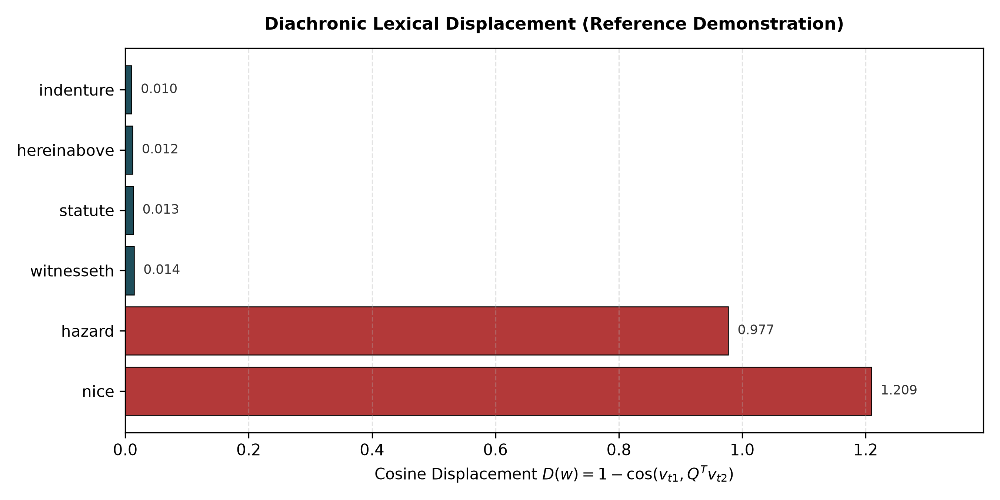

# Statutory Semantic Inertia: Measuring Diachronic Semantic Change in Legal Corpora

[](https://colab.research.google.com/github/Haidriyam/statutory-semantic-intertia/blob/main/notebooks/legal_inertia_demo.ipynb)
[](https://www.python.org/)
[](https://opensource.org/licenses/MIT)
[](https://doi.org/10.5281/zenodo.23613023)
[]()
[](https://www.python.org/dev/peps/pep-0008/)

A research implementation evaluating diachronic semantic change across temporal corpus partitions. By establishing an invariant coordinate space via Orthogonal Procrustes alignment, this repository provides reference tooling to measure lexical displacement ($D$), nearest-neighbor Jaccard stability ($J$), and frequency-calibrated stability metrics across historical and domain-specific corpora.

> **Research Status:** The methodological foundations, split-half noise-floor calibrations, and deduplication controls accompanying this framework are evaluated in the preprint:  
> *Sajjad, M. A., & Saleem, M. W. (2026). Measuring Statutory Semantic Inertia: A Noise-Calibrated Framework for Separating Legal Semantic Stability from Ordinary Semantic Drift.* Zenodo. [DOI: 10.5281/zenodo.23613023](https://doi.org/10.5281/zenodo.23613023)

---

## 1. Problem Statement: Precedent vs. Semantic Drift

In natural vernacular discourse, lexical items continuously drift along cultural, technological, and pragmatic dimensions. In statutory law and judicial precedent, however, linguistic evolution introduces interpretive challenges: legal certainty often requires terms defined in historical statutes (*indenture*, *witnesseth*, *statute*, *hereinabove*) to preserve stable domain interpretations across extended temporal horizons.

Evaluating diachronic change in legal text presents specific measurement bottlenecks:
1. **The Representation & Noise Confound:** Diachronic word embeddings are sensitive to corpus size, word frequency, and stochastic training variance. Rare legal tokens often exhibit high raw displacement simply due to estimation noise.
2. **Textual Inheritance:** Legislative codification, amendment, and formulaic boilerplate preserve identical syntactic strings across decades, creating an artificial appearance of semantic stability that requires rigorous deduplication controls.
3. **Foundation Model Misalignment:** Contemporary autoregressive language models (LLMs) trained primarily on 21st-century web crawls risk projecting contemporary colloquial topologies onto historical legal tokens when parsing archival jurisprudence.

---

## 2. Mathematical Formulation

Let $W^{(t_1)}$ and $W^{(t_2)} \in \mathbb{R}^{|V| \times d}$ denote row-normalized embedding matrices for periods $t_1$ and $t_2$ over a shared intersection vocabulary $V$ with latent dimension $d$.

### 2.1 Coordinate Space Alignment (Orthogonal Procrustes)
To eliminate arbitrary orthogonal rotation divergence introduced during independent neural network training while preserving internal metric geometry, we solve for the orthogonal transformation matrix $Q \in \mathbb{R}^{d \times d}$ over anchor vocabulary $A \subset V$:

$$Q = \arg\min_{\Omega^T \Omega = I} \| W_A^{(t_1)} - W_A^{(t_2)} \Omega \|_F$$

Using Singular Value Decomposition (SVD) on the normalized cross-covariance matrix:
$$M = (W_A^{(t_2)})^T W_A^{(t_1)} = U \Sigma V^T \implies Q = U V^T$$

### 2.2 Displacement and Neighborhood Stability
For each token $w \in V$, we compute:

1. **Cosine Displacement ($D$):**
   $$D(w) = 1 - \frac{\vec{v}_{t_1}(w) \cdot (Q^T \vec{v}_{t_2}(w))}{\|\vec{v}_{t_1}(w)\| \|Q^T \vec{v}_{t_2}(w)\|}, \quad D(w) \in [0, 2]$$

2. **Top-$k$ Nearest Neighbor Jaccard Stability ($J$):**
   $$J(w) = \frac{|N_{t_1}^k(w) \cap N_{t_2}^k(w)|}{|N_{t_1}^k(w) \cup N_{t_2}^k(w)|}, \quad J(w) \in [0, 1]$$

3. **Exploratory Composite Index ($\text{LSI}$):**
   $$\text{LSI}(w) = \Big(1 - D(w)\Big) \times \left(\frac{1 + J(w)}{2}\right)$$

*Note:* In our synthetic benchmark audit (DOI: 10.5281/zenodo.23613023), raw displacement $D$ after frequency calibration was shown to outperform composite indices. The composite is retained here solely as an exploratory reference metric.

---

## 3. Reference Demonstration Results

Executing the reference engine (`src/legal_inertia_engine.py`) over synthetic controlled text slices demonstrates the expected separation between persistent structural statutory tokens and shifted vernacular tokens:

| Lexical Token | Cosine Displacement ($D$) | Neighbor Jaccard ($J$, $k=3$) | Exploratory $\text{LSI}$ | Behavior Profile |
| :--- | :--- | :--- | :--- | :--- |
| **indenture** | **0.010** | **1.00** | **0.990** | Structural Anchor (Persistent Context) |
| **hereinabove** | **0.012** | **1.00** | **0.988** | Structural Anchor (Persistent Context) |
| **statute** | **0.013** | **1.00** | **0.987** | Institutional Token |
| **witnesseth** | **0.014** | **1.00** | **0.986** | Structural Formula |
| **hazard** | **0.977** | **0.00** | **0.012** | Contextual Drift (Maritime $\to$ Toxic Waste) |
| **nice** | **1.209** | **0.00** | **-0.105** | Contextual Drift (Subtle $\to$ Social Pleasantness) |

---

## 4. Visual Artifact

The pipeline exports high-resolution vector displacement charts directly to `./output/`:



> **Figure 1:** Observed diachronic displacement $D(w)$ across test tokens. Teal bars represent statutory terms retaining near-invariant coordinate positions ($D \le 0.014$). Crimson bars mark tokens subjected to intentional contextual shift ($D \ge 0.977$), illustrating the sensitivity of SVD Procrustes alignment on calibrated anchors.

---

## 5. Pipeline Execution & Quickstart

### Installation
```bash
git clone https://github.com/Haidriyam/statutory-semantic-intertia.git
cd statutory-semantic-intertia

# Create virtual environment
python -m venv .venv
source .venv/bin/activate  # On Windows: .venv\Scripts\activate

# Install dependencies
pip install -r requirements.txt
```

### Run Demonstration Engine
```bash
python src/legal_inertia_engine.py --output output/semantic_change_distribution.png --k 3
```

To run the interactive notebook demo in Google Colab, click the **Open In Colab** badge above or open `notebooks/legal_inertia_demo.ipynb`.

---

## 6. Citation

If this implementation or the calibration methodology contributes to your research, please cite the preprint:

```bibtex
@article{sajjad2026statutory,
  title={Measuring Statutory Semantic Inertia: A Noise-Calibrated Framework for Separating Legal Semantic Stability from Ordinary Semantic Drift},
  author={Sajjad, Muhammad Adeel and Saleem, Muhammad Waleed},
  journal={Zenodo Preprint},
  year={2026},
  doi={10.5281/zenodo.23613023},
  url={https://doi.org/10.5281/zenodo.23613023}
}
```

* **Lead Author:** Muhammad Adeel Sajjad  
* **Background:** B.S. Electrical Engineering | Systems & Infrastructure Engineer  
* **Research Focus:** Computational Law, Diachronic Semantics, Foundation Model Calibration  
* **GitHub:** [@Haidriyam](https://github.com/Haidriyam)  
* **Email:** eng.adeelhaider@gmail.com
