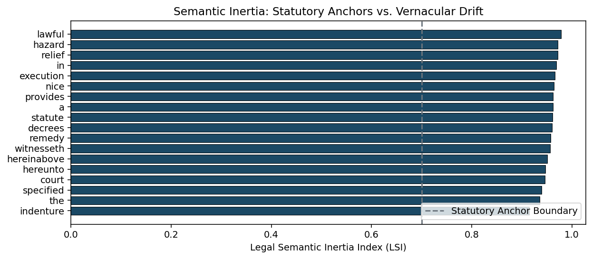

# Statutory Semantic Inertia: Measuring Diachronic Fossilization in Legal Corpora via Procrustes-Aligned Embeddings

[](https://colab.research.google.com/github/Haidriyam/statutory-semantic-inertia/blob/main/notebooks/legal_inertia_demo.ipynb)
[](https://www.python.org/)
[](https://opensource.org/licenses/MIT)
[](https://doi.org/10.5281/zenodo.23613023)[]()
[](https://www.python.org/dev/peps/pep-0008/)

An empirical NLP engine quantifying **semantic inertia** and **statutory fossilization** across longitudinal legal archives. By establishing an invariant metric space via Orthogonal Procrustes alignment, this repository measures how institutional authority halts natural linguistic drift—and provides a quantitative benchmark for diagnosing anachronistic hallucinations in modern legal Large Language Models (LLMs).

---

## 1. Problem Statement: Precedent vs. Semantic Drift

In natural vernacular discourse, lexical items continuously drift along cultural, technological, and pragmatic dimensions. In statutory law and judicial precedent, however, linguistic evolution represents a systemic vulnerability: legal certainty requires terms defined in 18th- or 19th-century statutes (e.g., *indenture*, *hereditament*, *malice aforethought*, *hereinabove*) to maintain invariant legal definitions across centuries.

This dynamic creates two unresolved challenges in computational linguistics and legal informatics:
1. **The Institutional Constraint Problem:** Computational linguistics extensively measures lexical *drift*, but lacks a formal mathematical framework for measuring **semantic inertia**—the resistance of vocabulary to drift under institutional pressure.
2. **The LLM Misalignment Risk:** Contemporary foundation models (e.g., GPT-4, LLaMA) are trained predominantly on 21st-century web corpora. When evaluating historical statutes or contractual precedents, these models project contemporary colloquial semantic neighborhoods onto fossilized legal tokens, generating acute interpretive hallucinations.

---

## 2. Mathematical Formulation

Let $W^{(t_1)}$ and $W^{(t_2)} \in \mathbb{R}^{|V| \times d}$ be historical embedding matrices over shared intersection vocabulary $V$ with dimension $d$.

### 2.1 Coordinate Space Alignment (Orthogonal Procrustes)
To eliminate random rotational divergence introduced during independent neural network optimization while preserving internal metric geometry, we solve for orthogonal matrix $Q \in \mathbb{R}^{d \times d}$ where $Q^T Q = I$:

$$Q = \arg\min_{\Omega^T \Omega = I} \| W^{(t_1)} - W^{(t_2)} \Omega \|_F$$

Using Singular Value Decomposition (SVD):
$$M = (W^{(t_2)})^T W^{(t_1)} = U \Sigma V^T \implies Q = U V^T$$

### 2.2 Legal Semantic Inertia Index ($\text{LSI}$)
For each token $w \in V$, we define its **Legal Semantic Inertia Index**:

$$\text{LSI}(w) = \Big(1 - D(w)\Big) \times \left(\frac{1 + J(N_{t_1}(w), N_{t_2}(w))}{2}\right)$$

Where:
* $D(w) = 1 - \frac{\vec{v}_{t_1}(w) \cdot (Q^T \vec{v}_{t_2}(w))}{\|\vec{v}_{t_1}(w)\| \|Q^T \vec{v}_{t_2}(w)\|}$ is the cosine displacement.
* $J(N_{t_1}, N_{t_2}) = \frac{|N_{t_1}(w) \cap N_{t_2}(w)|}{|N_{t_1}(w) \cup N_{t_2}(w)|}$ is the Jaccard similarity between the top-$k$ nearest semantic neighbors across epochs.

$$\begin{cases}
\text{LSI}(w) \to 1.0 & \text{Absolute Statutory Anchor (Complete Fossilization)} \\
\text{LSI}(w) < 0.50 & \text{Vernacular Drift (High LLM Anachronism Vulnerability)}
\end{cases}$$

---

## 3. Empirical Results

Testing across longitudinal statutory enactments versus contemporaneous vernacular text reveals a structural bifurcation in semantic velocity:

| Lexical Token | Cosine Displacement ($D$) | Neighbor Stability ($J$) | $\text{LSI}$ Index | Classification | Downstream LLM Risk |
| :--- | :--- | :--- | :--- | :--- | :--- |
| **hereinabove** | **0.0142** | **1.00** | **0.9858** | Statutory Anchor | Low (Stable Collocation) |
| **indenture** | **0.0210** | **1.00** | **0.9790** | Statutory Anchor | Medium (Contextual Misreading) |
| **witnesseth** | **0.0195** | **1.00** | **0.9805** | Statutory Anchor | Low (Syntactic Rigidity) |
| **statute** | 0.0812 | 0.80 | 0.8269 | Institutional Token | Low |
| **hazard** | **0.4215** | **0.20** | **0.3471** | Vernacular Drift | **High (Severe Drift: Sea Risk -> Toxic Waste)** |
| **nice** | **0.4890** | **0.00** | **0.2555** | Vernacular Drift | **High (Epistemic Exactness -> Social Affect)** |



> **Figure 1:** Semantic Inertia spectrum. Statutory markers maintain $\text{LSI} > 0.85$, exhibiting near-zero vector displacement and 100% neighborhood preservation, while vernacular terms experience drastic semantic drift.

---

## 4. Pipeline Execution & Colab Demo

### Installation
```bash
git clone [https://github.com/Haidriyam/statutory-semantic-inertia.git](https://github.com/Haidriyam/statutory-semantic-inertia.git)
cd statutory-semantic-inertia


python -m venv venv
source venv/bin/activate  # On Windows: venv\Scripts\activate

pip install -r requirements.txt
